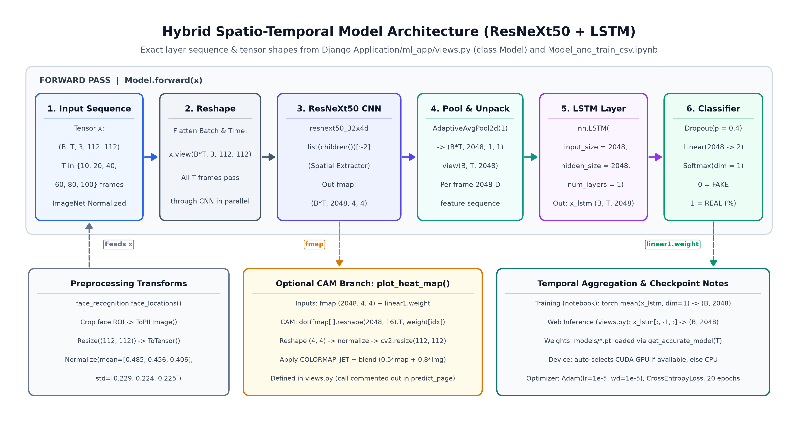
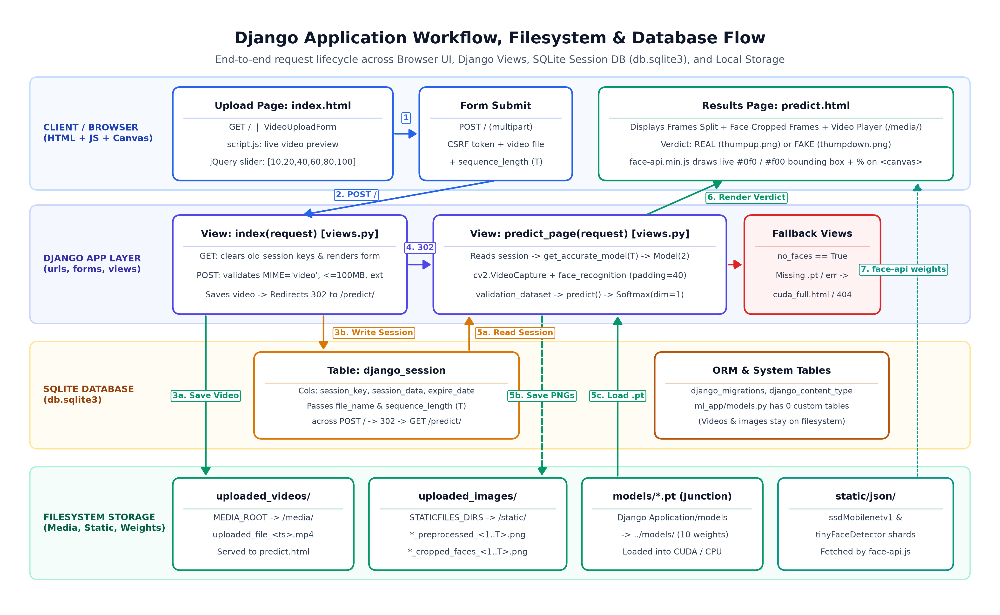
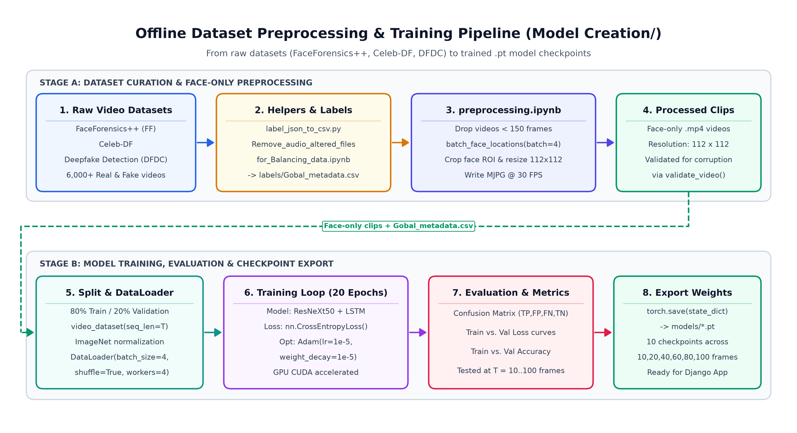
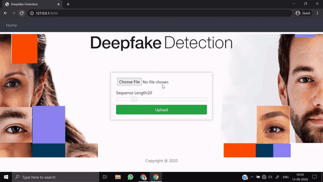
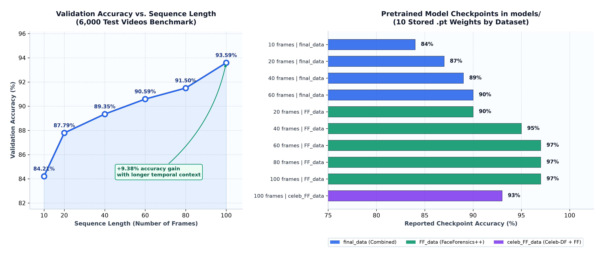

# Deepfake Video Detection Using Deep Learning (ResNeXt50 + LSTM)

## Project Overview

With the rapid advancement of generative artificial intelligence and deep generative models (such as Deepfakes, Autoencoders, and Generative Adversarial Networks), synthetic media creation has become increasingly accessible and realistic. While these technologies have legitimate creative applications, malicious deepfakes present critical security, ethical, and societal challenges—including identity theft, digital fraud, defamation, and misinformation.

This project implements an end-to-end deep learning system for **automated video deepfake detection**. By analyzing both spatial facial anomalies and temporal inconsistencies across consecutive video frames, the system classifies an input video as **REAL** or **FAKE** and provides an associated confidence score. An interactive **Django web application** is integrated to allow users to upload videos, view preprocessing previews, and inspect classification results in real time.

---

## System Architecture

The core architecture uses a hybrid **Spatio-Temporal Deep Learning** approach combining a Convolutional Neural Network (CNN) with a Recurrent Neural Network (RNN):

```
+------------------+      +-------------------+      +-------------------------+
|   Input Video    | ---> |  Face Detection   | ---> | Sequence Normalization  |
|  (.mp4, .avi...) |      |  & Cropping (112) |      |   (Frames: 10 to 100)   |
+------------------+      +-------------------+      +-------------------------+
                                                                  |
                                                                  v
+------------------+      +-------------------+      +-------------------------+
| Prediction Output| <--- |   LSTM Sequence   | <--- | Spatial Feature Vector  |
| (REAL / FAKE %)  |      |   Classification  |      |    (ResNeXt50 - 2048D)  |
+------------------+      +-------------------+      +-------------------------+
```

### 1. Spatial Feature Extractor (ResNeXt50-32x4d)
- Uses transfer learning with a **ResNeXt50** backbone truncated prior to the fully connected classification head.
- Extracts high-level spatial facial feature maps of dimension `2048` from each cropped face image (`112x112` resolution).
- Captures fine-grained spatial manipulation artifacts such as boundary blending, abnormal skin textures, and resolution mismatches.

### 2. Temporal Sequence Model (LSTM)
- Video deepfakes frequently contain temporal incoherence (e.g., unnatural eye blinking rates, jitter, or temporal lighting shifts across frames).
- An **LSTM (Long Short-Term Memory)** network receives the sequence of 2048-dimensional feature vectors (`batch_size, sequence_length, 2048`).
- The sequential dynamics are pooled across the sequence dimension and passed through a `Dropout(0.4)`, `LeakyReLU`, and a linear classification head.

### 3. Classification Head
- Computes logit outputs for binary classes (`0 = FAKE`, `1 = REAL`).
- Applies `Softmax` over logits to produce normalized confidence percentages.

<p align="center">
  
</p>

### 4. Detailed Model Architecture & Tensor Flow
<p align="center">
  
</p>

### 5. Django Application Workflow, Filesystem & Database Flow
<p align="center">
  
</p>

### 6. Offline Preprocessing & Training Pipeline
<p align="center">
  
</p>

---

## Key Features & Highlights

- **Hybrid Spatio-Temporal Pipeline**: Leverages both spatial representation (ResNeXt50) and temporal continuity (LSTM).
- **Multi-Sequence Model Support**: Accommodates variable sequence lengths (10, 20, 40, 60, 80, 100 frames) with automatic model resolution.
- **Automated Face Extraction**: Extracts and aligns facial regions of interest using computer vision preprocessing (`OpenCV`, `face_recognition`).
- **Interactive Web Interface**: A complete Django-based user interface allowing video upload, frame preview rendering, and result visualization.
- **Cross-Platform & CPU/GPU Compatibility**: Supports execution on NVIDIA CUDA GPUs as well as standard CPU environments.

---

## Application Demo

<p align="center">
  
</p>

---

## Experimental Results & Performance Analysis

The model was evaluated across multiple frame sequence lengths using balanced benchmarks derived from **FaceForensics++**, **Celeb-DF**, and the **Deepfake Detection Challenge (DFDC)** datasets over a test set of 6,000 videos:

| Model Checkpoint | Sequence Length (Frames) | Test Dataset Size | Validation Accuracy |
|:-----------------|:------------------------:|:-----------------:|:-------------------:|
| `model_84_acc_10_frames_final_data.pt` | 10 | 6,000 videos | **84.21%** |
| `model_87_acc_20_frames_final_data.pt` | 20 | 6,000 videos | **87.79%** |
| `model_89_acc_40_frames_final_data.pt` | 40 | 6,000 videos | **89.35%** |
| `model_90_acc_60_frames_final_data.pt` | 60 | 6,000 videos | **90.59%** |
| `model_91_acc_80_frames_final_data.pt` | 80 | 6,000 videos | **91.50%** |
| `model_93_acc_100_frames_final_data.pt` | 100 | 6,000 videos | **93.59%** |

### Observations
1. **Correlation with Sequence Length**: Model accuracy steadily increases with longer frame sequences—from **84.21%** (10 frames) to **93.59%** (100 frames).
2. **Temporal Cue Importance**: The ~9.4% accuracy gain when increasing frames from 10 to 100 confirms that temporal consistency provides critical discriminative signals that single-frame detectors miss.
3. **Inference Trade-off**: Shorter sequence models (e.g., 10 or 20 frames) provide faster inference latency suitable for near-real-time evaluation, whereas 100-frame sequences yield maximum forensic precision.

<p align="center">
  
</p>

---

## Directory Structure

```
Deepfake_detection_using_deep_learning/
├── Django Application/             # Web application root
│   ├── manage.py                   # Django management script
│   ├── project_settings/           # Django settings, routing, ASGI/WSGI
│   ├── ml_app/                     # Deep learning application module
│   │   ├── views.py                # Pipeline, inference logic & Model class
│   │   ├── forms.py                # Video upload form handling
│   │   └── templates/              # HTML frontend templates
│   ├── static/                     # CSS, JavaScript & client-side assets
│   ├── requirements.txt            # Python dependencies (Linux/Docker)
│   └── requirements-local.txt      # Python dependencies (Local Windows)
├── Model Creation/                 # Training & exploration notebooks
│   ├── preprocessing.ipynb         # Frame extraction & face alignment
│   ├── Model_and_train_csv.ipynb   # PyTorch model training pipeline
│   ├── Predict.ipynb               # Standalone prediction test notebook
│   └── Helpers/                    # Dataset preparation & balancing scripts
├── Documentation/                  # Research documentation & reports
│   ├── Project Report.pdf          # Full academic project report
│   ├── ESE presentation.pptx       # Presentation slide deck
│   ├── IJSRDV8I10860.pdf           # Research reference paper
│   └── B1_poster .pdf              # Project presentation poster
├── models/                         # Pretrained PyTorch weight checkpoints (.pt)
├── github_assets/                  # Visual assets (architecture diagram, demo gif)
├── run_local.bat                   # 1-click Windows Batch launch script
├── run_local.ps1                   # 1-click PowerShell launch script
└── test_e2e_pipeline.py            # Automated end-to-end test script
```

---

## Technical Stack

| Component | Technology |
|:----------|:-----------|
| **Deep Learning Framework** | PyTorch, Torchvision |
| **Model Architectures** | ResNeXt50-32x4d (CNN) + LSTM (RNN) |
| **Computer Vision** | OpenCV (`cv2`), `face_recognition`, PIL |
| **Backend Web Framework** | Django 3.x |
| **Frontend** | HTML5, CSS3, JavaScript, Bootstrap, jQuery |
| **Deployment / Scripts** | Windows Batch (`.bat`), PowerShell (`.ps1`), Docker |

---

## Installation & Setup Guide

### Prerequisites
- Python 3.8 to 3.10
- Git
- (Optional) NVIDIA GPU with CUDA support for accelerated inference

### Step 1: Clone or Open the Project
Ensure you are in the project root directory:
```bash
cd Deepfake_detection_using_deep_learning
```

### Step 2: Set Up Virtual Environment
Create and activate an isolated Python environment:
```powershell
# Windows (PowerShell)
python -m venv .venv
.\.venv\Scripts\Activate.ps1
```
```bash
# Linux / macOS
python3 -m venv .venv
source .venv/bin/activate
```

### Step 3: Install Required Dependencies
```bash
pip install -r "Django Application/requirements-local.txt"
```

### Step 4: Verify Pretrained Weights
Ensure that trained `.pt` model files are placed in the `models/` directory (e.g. `model_84_acc_10_frames_final_data.pt`).

---

## Running the Project

### Option A: Quick Launch Scripts (Windows)
Double-click `run_local.bat` or execute in PowerShell:
```powershell
.\run_local.ps1
```
The script automatically sets up the environment, links model paths, and starts the local server.

### Option B: Manual Django Launch
```bash
cd "Django Application"
python manage.py migrate
python manage.py runserver 127.0.0.1:8000
```
Open your browser and navigate to:
**`http://127.0.0.1:8000/`**

### Option C: Run End-to-End Test Suite
To verify model initialization, weights loading, forward pass, and video prediction without opening the browser:
```powershell
python test_e2e_pipeline.py
```

---

## Project Methodology Summary

1. **Video Ingestion**: Video files (`.mp4`, `.avi`, `.webm`) are uploaded via the Django interface.
2. **Face Extraction**: Each frame is sampled; facial regions are located, cropped, and resized to $112 \times 112$ pixels.
3. **Data Transformation**: Cropped frames are normalized using ImageNet distribution parameters ($\mu = [0.485, 0.456, 0.406]$, $\sigma = [0.229, 0.224, 0.225]$).
4. **Spatial Feature Representation**: ResNeXt50 extracts dense feature maps from each frame.
5. **Temporal Sequence Analysis**: The LSTM processes the temporal ordered sequence of representations to detect inter-frame discrepancies.
6. **Output & Confidence**: The output is rendered on the web page showing classification (REAL or FAKE), probability percentage, and frame previews.

---

## Conclusion & Future Scope

### Conclusion
This project successfully demonstrates an accurate and reliable system for detecting deepfake videos by integrating spatial feature extraction via ResNeXt50 with temporal sequence analysis via LSTM. Achieving up to **93.59% accuracy** on a 100-frame sequence, the solution underscores the necessity of analyzing sequential temporal dynamics to distinguish synthetic faces from genuine human recordings.

### Future Scope
- **Multimodal Audio-Visual Detection**: Integrating audio stream analysis to detect synthetic speech and lip-sync discrepancies.
- **Vision Transformers (ViT)**: Exploring spatio-temporal attention architectures (e.g., Video Vision Transformers) for capturing long-range interactions.
- **Model Quantization & Mobile Deployment**: Quantizing weights (INT8 / ONNX) to enable lightweight edge inference on mobile or browser platforms.
